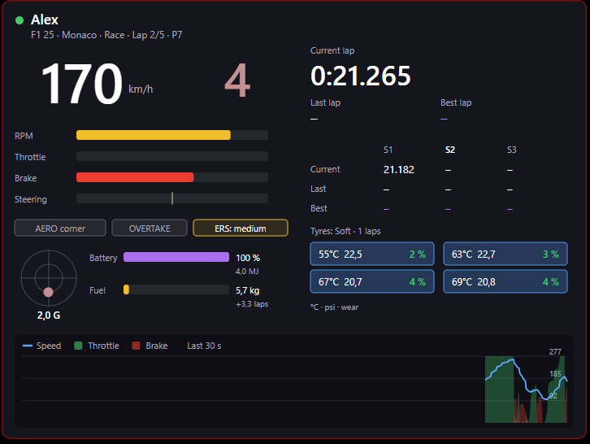
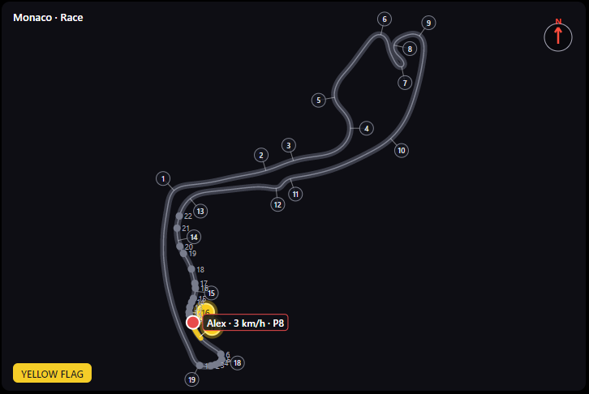
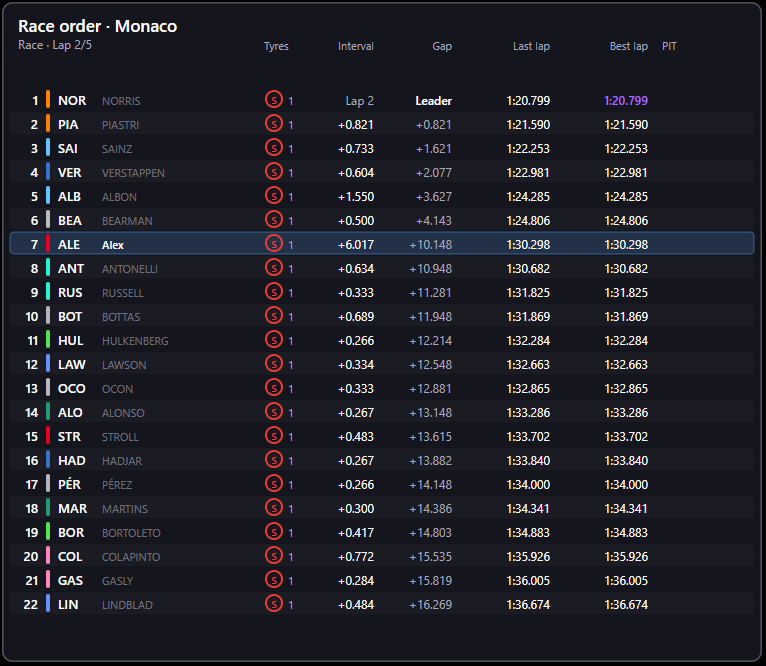
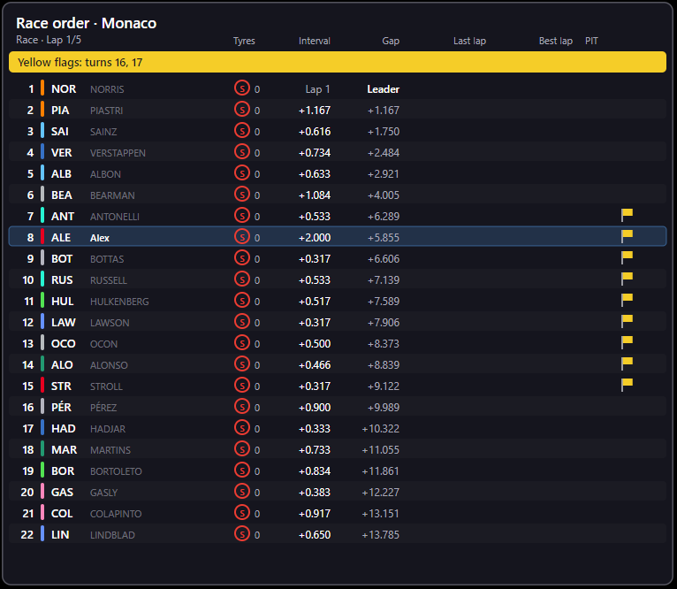

  

**English** · [Čeština](README.cs.md)

**RaceEngineer** is a desktop application (Windows and Linux / Steam Deck) that records and analyses telemetry from **F1 25** (UDP, 2026 Season Pack format).

- records UDP telemetry into SQLite
- home page with the circuits of the game: map, named turns, lap record and your own sessions
- lap analysis: channel charts, track map, lap comparison, sectors, positions, car setup, tyres
- race strategy planner (pit window, safety car, penalties)
- live dashboard: rider cards, race order with gaps and tyres, track map with yellow/red flags and numbered turns, crash and incident alerts
- also records Forza Horizon 5 / 6 (Data Out): world map and circuits recognised from the start line
- MCP server that lets an AI read the telemetry and control the application
- English (default) and Czech interface; the application updates itself from the releases here

## Screenshots

**Live dashboard** – every module can be moved by dragging its header.

 

 

## Download

Packages are published on the [Releases](../../releases) page: `RaceEngineer-win-x64.zip` (Windows) and `RaceEngineer-linux-x64.zip` (Linux / Steam Deck, run `chmod +x RaceEngineer` once after unpacking). Unpack the **whole folder** and start `RaceEngineer`. Each package has a `.sha256` file for verification. The source code is not public.

## Game setup

In the game: Settings → Telemetry → UDP Telemetry on, IP `127.0.0.1`, port `20777`, 20 Hz.

## Language and updates

*File → Settings* lets you choose English or Czech (applied after a restart) and switch the automatic check for new versions on or off. *Help → Check for updates* checks manually.

## Data sources

Circuit data and images come from Wikipedia and Wikimedia Commons (CC BY-SA and other licences); authors and licences are listed in `Assets/CREDITS.md` inside the package. F1 and F1 25 are trademarks of their owners; this project is not affiliated with them.
